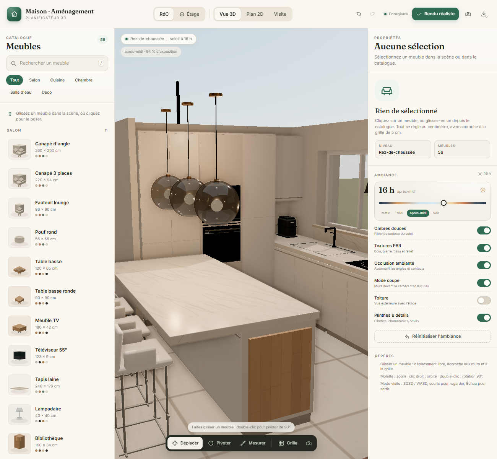
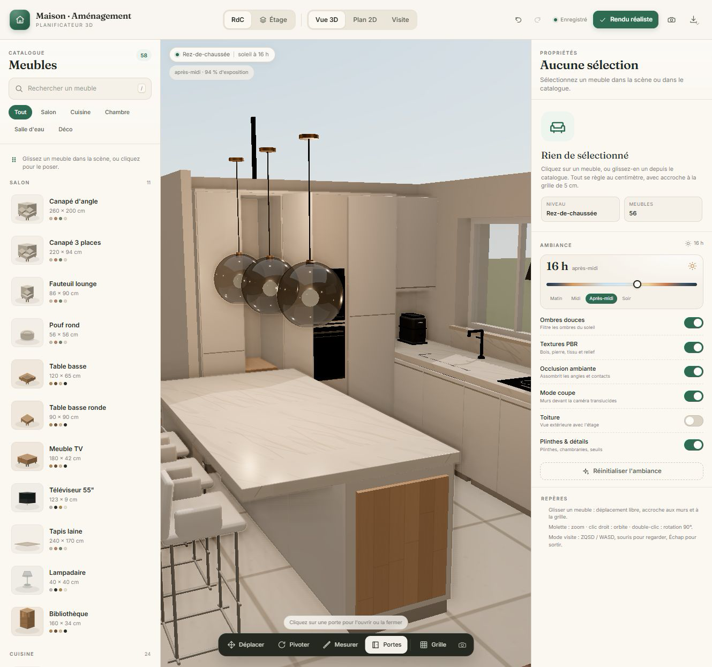
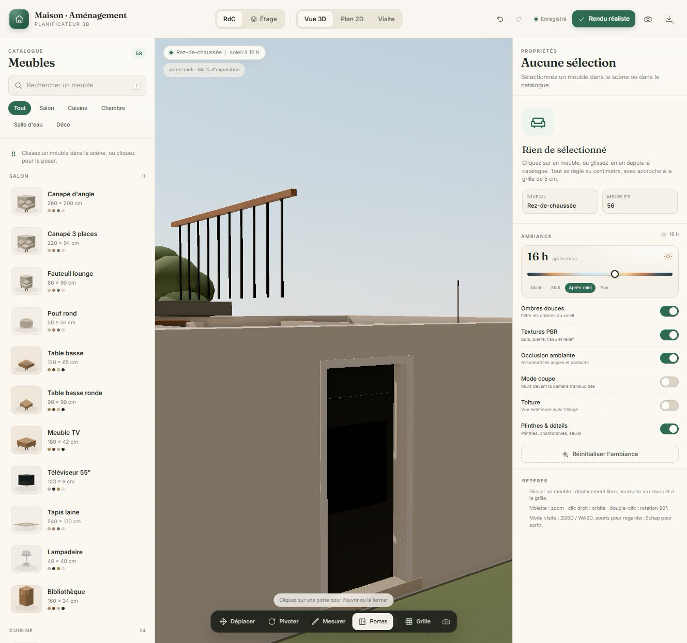

# Maison · Planificateur d'aménagement 3D

Application web **100 % front** pour aménager la maison à l'échelle réelle :
poser, déplacer, pivoter et mesurer des meubles, puis visualiser le résultat
dans une scène 3D éclairée par le soleil, en plan 2D ou en visite à la première
personne.

Le projet est volontairement séparé du portail CasaRenous : aucun backend, aucune
base de données, aucun identifiant. Il se déploie comme un site statique.



---

## 1. Démarrage

### Depuis le dépôt

```bash
npm install
npm run dev:planner
```

→ <http://localhost:5180>

### Depuis le dossier de l'application

C'est le mode « projet autonome » : `apps/planner` a son propre `package.json`.

```bash
cd apps/planner
npm install
npm run dev
```

### Build de production

```bash
npm run build:planner
# ou
cd apps/planner && npm run build
```

Le résultat est dans `apps/planner/dist`. Le `base` Vite vaut `./` : le dossier
fonctionne à la racine d'un domaine **ou** dans un sous-dossier statique. Les GLB
sont copiés depuis `public/models`.

### Vérifications

```bash
npm run typecheck -w @casarenous/planner
```

### Intégration au carnet CasaRenous

Le portail expose une entrée **Aménagement** dans la navigation, entre
**Piazza** et **3D**. La page `/amenagement` ouvre le planificateur en
**workspace plein écran** : le portail reste la porte d'entrée, puis le
planificateur affiche son propre en-tête avec un lien **Retour** vers le carnet.

L'intégration utilise un **iframe isolé** pour deux raisons :

- le CSS, le canvas WebGL et les raccourcis clavier du planificateur ne
  perturbent pas la PWA Aura ;
- le planificateur reste une application statique autonome, réutilisable telle
  quelle.

En développement, le portail charge `http://<hôte>:5180/`. Le script racine
`npm run dev` démarre le portail **et** le planificateur. Pour lancer les deux
séparément :

```bash
npm run dev:portal
npm run dev:planner
```

Les ports de développement sont **stricts** (5173 pour le portail, 5180 pour le
planificateur) pour éviter qu'un serveur bascule silencieusement sur 5181 et que
l'iframe pointe vers une mauvaise instance. Si un port est déjà occupé, arrêtez
l'ancien serveur (ou utilisez `VITE_PLANNER_URL`).

En production, `npm run build` compile le planificateur avec le base
`/amenagement-app/` et le copie dans `apps/portal/public/amenagement-app` avant
le build du portail. Nginx sert ce sous-dossier avec des en-têtes autorisant le
cadre de même origine. Le Dockerfile du portail fait la même opération.

Variables utiles :

```bash
# forcer une autre URL de planificateur (dev ou déploiement séparé)
VITE_PLANNER_URL=http://localhost:5180/
```

---

## 2. Stack

- **React 19 + Vite 7 + TypeScript**
- **Tailwind CSS 4** (via `@tailwindcss/vite`) et design system CSS dans
  `src/index.css`
- **@react-three/fiber 9 + @react-three/drei**
- **Three.js 0.177**
- **zustand** pour l'état, `persist` pour `localStorage`
- **Polices** Inter Variable et Fraunces Variable (OFL, via `@fontsource`)

Post-traitement : `SSAOPass` + `OutputPass` de Three.js, avec **tone mapping AgX**
et exposition réglable. Les ombres douces utilisent `SoftShadows` (PCSS) de drei.

---

## 3. Vue d'ensemble des fichiers

```text
apps/planner/
├─ public/
│  ├─ favicon.svg
│  └─ models/
│     └─ vase-sculptural.glb      # modèle GLB de démonstration (généré)
├─ scripts/
│  └─ generate-demo-glb.mjs       # régénère le GLB de démonstration
├─ src/
│  ├─ App.tsx                     # layout 3 colonnes, raccourcis, autosave
│  ├─ index.css                   # tokens, panneaux, toolbar, responsive
│  ├─ config/
│  │  ├─ house.json               # TOUTES les cotes de la maison
│  │  └─ example.ts               # aménagement d'exemple
│  ├─ types.ts                    # types de la config, du catalogue, des meubles
│  ├─ catalog/catalog.ts          # catalogue et variantes de matières
│  ├─ store/planner.ts            # meubles, historique, ambiance, persistance
│  ├─ lib/
│  │  ├─ sun.ts                   # position du soleil selon l'heure
│  │  ├─ textures.ts              # textures PBR procédurales (canvas)
│  │  ├─ placement.ts             # grille 5 cm, collisions, accroche murs
│  │  └─ place.ts                 # helpers de placement liés au store
│  ├─ components/                 # TopBar, catalogue, inspecteur, toolbar, HUD
│  └─ scene/
│     ├─ HouseScene.tsx           # composition de la scène
│     ├─ Walls.tsx                # murs, ouvertures, portes, plinthes, coupe
│     ├─ Floors.tsx               # sols, dalles, seuils, plafond de visite
│     ├─ Lighting.tsx             # soleil, ciel, IBL, lampes
│     ├─ Effects.tsx              # SSAO + tone mapping
│     ├─ Roof.tsx / Stairs.tsx / Site.tsx
│     ├─ Furniture.tsx            # placement, drag, sélection, mesure
│     └─ furniture/
│        ├─ models.tsx            # meubles paramétriques + branche GLB
│        └─ palette.ts            # matières PBR des variantes
```

---

## 4. Modifier les cotes de la maison

### 4.1 Fichier unique

Tout est dans **`src/config/house.json`**. Aucune cote de la maison n'est en dur
dans les composants. Après modification, rechargez la page : Vite fait le HMR.

Le fichier est découpé en :

| Section | Rôle |
| --- | --- |
| `meta` | nom, version, unité, repère |
| `envelope` | emprise, épaisseur des murs, hauteur, plancher, pente de toit |
| `materials` | matières PBR de l'architecture (couleur, rugosité, textures) |
| `levels` | RdC et étage : altitude, hauteur, dalle, sol |
| `rooms` | rectangles de pièces, sol, libellé, surface |
| `walls` | murs, épaisseurs, hauteurs et ouvertures |
| `stairs`, `roof`, `site` | escalier, toiture, extérieurs |
| `ambience` | heure, exposition, options de rendu |
| `camera` | caméra 3D initiale (coordonnées three) |

### 4.2 Repère

- `walls`, `rooms`, `stairs`, `site` utilisent le **repère du plan** :
  `x` vers l'est, `y` vers le nord, origine en bas à gauche du RdC, façade avant
  à `y = 0`.
- À l'écran, le plan est affiché avec le nord en haut et l'est à droite.
- Three.js utilise `y` pour la hauteur et `z` vers le sud : la conversion
  `z_three = -y_plan` est faite au rendu (`worldZ`, `wallRenderTransform`).
- La section `camera` est l'exception : elle est directement en coordonnées
  three (x est, y haut, z sud), car c'est une caméra et non une cote de plan.

### 4.3 Murs et ouvertures

Un mur est un segment de centreline, avec une épaisseur et une hauteur :

```json
{
  "id": "ext-sud",
  "level": "rdc",
  "from": [0, 0.19],
  "to": [7, 0.19],
  "thickness": 0.38,
  "material": "plaster",
  "exterior": true,
  "baseboard": "auto",
  "openings": [
    { "from": 0.9, "to": 2.3, "sill": 1.10, "top": 2.15, "type": "window", "divisions": 2 },
    { "from": 4.2, "to": 6.6, "sill": 0, "top": 2.0, "type": "garage" }
  ]
}
```

- `from` / `to` du mur : points du plan. Un mur horizontal court selon `x`, un
  mur vertical court selon `y`.
- `from` / `to` d'une ouverture : **coordonnées absolues le long de l'axe du
  mur** (x pour un mur est-ouest, y pour un mur nord-sud). Elles doivent être
  comprises entre les extrémités du mur.
- `sill` : allège, en mètres au-dessus du sol du niveau.
- `top` : hauteur du haut de l'ouverture.
- `type` : `window`, `door`, `garage`, `bay` ou `passage`.
- `divisions` : nombre de vantaux/travées vitrées.
- `hinge` / `swing` : sens d'ouverture des portes intérieures.
- `baseboard` : `auto` (côté intérieur), `both`, `none`.
- `exterior` : active la coupe et l'accroche de façade.

Les murs sont découpés en segments autour des ouvertures (pas de CSG) :

- montants latéraux ;
- allège sous la fenêtre ;
- linteau au-dessus ;
- cadre, vitrage, appui intérieur et extérieur ;
- porte intérieure avec chambranle et vantail ouvrant ;
- porte d'entrée pleine ;
- porte de garage sectionnelle avec rainures ;
- plinthes et seuils.

Pour ajouter un mur, dupliquez un bloc et changez `id`, `from`, `to`,
`thickness` et `material`. Pour ajouter une ouverture, ajoutez un élément dans
`openings`.

### 4.4 Pièces et sols

```json
{
  "id": "sejour",
  "name": "Séjour",
  "level": "rdc",
  "rect": [0.38, 6.95, 3.84, 13.42],
  "floor": "oakFloor",
  "labelAt": [2.0, 11.6],
  "program": "Séjour"
}
```

`rect` est `[x0, y0, x1, y1]` en plan. Le sol de base du niveau est défini par
`levels[].floorMaterial` ; une pièce dont `floor` diffère reçoit une surcouche
(tuile, béton…). Les libellés du plan 2D utilisent `labelAt` (ou le centre).

Chaque pièce porte un champ `areaM2` reprenant le **tableau de surfaces
définitif** fourni par Maisons Belles Demeures ; c'est cette valeur qui est
affichée dans le plan 2D (`PlanLabels.tsx`). Le champ est optionnel : à défaut,
la surface est calculée depuis le `rect`. Les `rect` restent des approximations
géométriques — ils ne sont pas recalculés pour coller au m² officiel.

La cuisine, le séjour ouest et le séjour est forment une seule **Pièce de vie**
: une seule étiquette « Pièce de vie · 41,1 m² » est placée au centre du volume,
les deux autres zones portent `hideLabel: true` et n'affichent plus d'étiquette.

Surfaces définitives (m²) : RDC — Pièce de vie 41,11 · Entrée 2,24 · Cellier
4,27 · Garage 14,38 · Chambre 1 9,98 · Salle d'eau 2,32 · Dégagement 1,95 · WC
1,16 · Placard 0,61. Étage — Chambre 2 13,23 · Chambre 3 12,87 · Chambre 4 12,08
· Chambre 5 (parentale) 12,92 · Salle d'eau 2 4,25 · Bains 4,63 · WC 2 1,27 ·
Dressing 4,38 · Palier 10,09. Total habitable : 139,36 m².

### 4.5 Niveaux et étage

Le RdC est à `elevation: 0`. L'étage est à `2.72` (2,50 m de hauteur + 0,22 m de
dalle) et sa hauteur sous plafond est de 2,50 m.

L'étage est aujourd'hui une **esquisse** issue du script Blender : les cloisons,
ouvertures et pièces sont dans le JSON avec `provisional: true`, mais les cotes
définitives ne sont pas encore fournies. Pour les remplacer :

1. modifiez `levels[1].elevation`, `ceilingHeight`, `slabThickness` ;
2. remplacez les murs `up-*` dans `walls` ;
3. remplacez les pièces `level: "etage"` dans `rooms` ;
4. ajustez `floorRects` si la trémie d'escalier change.

### 4.6 Toiture, escalier, extérieurs

- `roof.pitch` : pente en degrés ; le faîtage court selon `y` (axe `z` en three).
- `roof.overhangSide` / `overhangGable` : débords.
- `stairs.steps` : 13 contremarches, avec marches balancées et volée droite.
- `site` : terrasse, enrobé de l’entrée, arbres et haies. Les rectangles sont en plan.

### 4.7 Matières et textures

Les matières d'architecture sont dans `materials` :

```json
"oakFloor": {
  "name": "Chêne huilé",
  "color": "#a97445",
  "roughness": 0.68,
  "metalness": 0,
  "texture": "wood",
  "textureScale": 1.15,
  "bump": 0.02
}
```

- `texture` : générateur procédural (`wood`, `tile`, `plaster`, `concrete`,
  `stone`, `fabric`, `grass`).
- `textureScale` : taille physique d'un motif en mètres. Le `repeat` est calculé
  à partir de la taille réelle de la surface.
- `bump` : force de la normal map.
- `clearcoat`, `sheen`, `emissive` sont optionnels.
- Pour utiliser des images externes, ajoutez `textures` :

```json
"textures": {
  "map": "/textures/chene/albedo.jpg",
  "normalMap": "/textures/chene/normal.jpg",
  "roughnessMap": "/textures/chene/roughness.jpg"
}
```

Placez les fichiers dans `apps/planner/public/textures/...`. Les chemins sont
relatifs à `public`. Si un fichier manque, la matière retombe proprement sur sa
couleur et/ou sa texture procédurale.

Le toggle **Textures PBR** de l'inspecteur désactive les maps pour comparer.

---

## 5. Ajouter un meuble au catalogue

Le catalogue est dans **`src/catalog/catalog.ts`**. Chaque entrée est un
`CatalogItem` :

```ts
{
  id: "mon-canape",
  name: "Mon canapé",
  category: "Salon",
  kind: "sofa",                 // modèle paramétrique de repli
  w: 2.10, d: 0.95, h: 0.82,    // mètres
  variants: FABRICS,            // au moins une variante
  defaultVariant: "lin-sable",
  elevation: 0,                 // surélévation éventuelle
  allowOverlap: false,          // tapis, tableaux, suspensions…
  keywords: "canapé tissu",
  model: { url: "/models/mon-canape.glb", rotation: 0 }
}
```

### 5.1 Dimensions et collisions

`w`, `d`, `h` sont en **mètres** et servent à :

- l'emprise de collision (rectangle orienté) ;
- l'accroche aux murs ;
- le calibrage d'un GLB ;
- l'affichage dans le catalogue et l'inspecteur.

Pour un meuble mural ou posé sur un autre meuble, utilisez `elevation` et
`allowOverlap: true` (tableau, miroir, hotte, lampe de table…). Les tapis
utilisent `allowOverlap: true` et une hauteur quasi nulle.

### 5.1 bis Redimensionner une instance

Chaque meuble **posé** peut avoir ses propres cotes, sans modifier le catalogue.
Dans l'inspecteur, la section **Dimensions** expose :

- **Largeur** (cm) ;
- **Profondeur** (cm) ;
- **Hauteur** (cm).

La modification est immédiate et s'applique à :

- la géométrie du meuble (mise à l'échelle) ;
- l'emprise de collision et l'accroche aux murs ;
- la sélection, le plan et l'étiquette de dimensions ;
- les collisions de la visite à la première personne ;
- la duplication et l'export JSON.

Ces cotes sont stockées dans l'instance :

```json
"size": { "w": 2.8, "d": 2.0, "h": 0.86 }
```

Si `size` est absent, le meuble reprend les cotes du catalogue. Le bouton
**Revenir aux cotes catalogue** supprime la personnalisation ; l'opération est
annulable avec `Ctrl+Z`.

Une modification de taille peut provoquer une collision (badge **Collision**) :
déplacez ensuite le meuble, ou réduisez-le. Les cotes de la **maison** (murs,
pièces, ouvertures) ne sont pas modifiées par ce panneau : elles restent dans
`house.json`.

### 5.2 Ajouter un GLB

1. Déposez le fichier dans `public/models/`, par exemple
   `public/models/mon-canape.glb`.
2. Ajoutez `model: { url: "/models/mon-canape.glb", rotation: 0 }` à l'entrée.
3. Le modèle est automatiquement :
   - copié dans la scène ;
   - centré en X/Z ;
   - posé sur le sol (le bas du GLB est aligné sur `y = 0`) ;
   - mis à l'échelle pour tenir dans `w × d × h` ;
   - configuré pour projeter et recevoir les ombres.
4. `rotation` est en **degrés** autour de Y (utile si le modèle est orienté
   autrement que le catalogue).
5. Si le fichier est absent ou invalide, le rendu procédural `kind` est utilisé
   automatiquement (un avertissement est écrit dans la console, le meuble reste
   manipulable).

Le **vase sculptural** du catalogue est un exemple réel :
`public/models/vase-sculptural.glb`, généré par
`scripts/generate-demo-glb.mjs` (`node apps/planner/scripts/generate-demo-glb.mjs`).
Vous pouvez le remplacer par n'importe quel GLB libre de droits.

> Les variantes de matière du catalogue ne recolorent pas un GLB : celui-ci
> conserve ses matériaux. Pour des variantes sur un modèle 3D, préparez plusieurs
> GLB ou étendez `GlbModel` dans `src/scene/furniture/models.tsx`.

### 5.3 Ajouter un modèle paramétrique

Si vous ne fournissez pas de GLB, le meuble est construit par le composant
`ProceduralModel` dans `src/scene/furniture/models.tsx`. Le champ `kind` choisit
la forme : `sofa`, `sofaCorner`, `armchair`, `pouf`, `coffeeTable`, `roundTable`,
`tvUnit`, `tv`, `rug`, `plant`, `floorLamp`, `shelf`, `kitchenIsland`, `counter`,
`fridge`, `hood`, `diningTable`, `diningChair`, `pendant`, `bed`, `nightstand`,
`wardrobe`, `desk`, `officeChair`, `shower`, `vanity`, `toilet`, `bathtub`,
`radiator`, `mirror`, `art`, `curtain`, `vase`, `tableLamp`, `cushion`,
`kitchenOvenBank`, `kitchenBase`, `wineFridge`, `marbleTop`, `blackSink`,
`blackTap`, `inductionHob`, `angledHood`, `marbleIsland`, `wireStool`,
`smokedGlobePendant`, `floatingShelf`, `bookStack`, `trailingPlant`,
`botanicalArt`, `cuttingBoard`, `coffeeMachine`, `marbleBacksplash`,
`kitchenUpper`, `stoneFloor`, `consoleTable`, `sideTable`, `dishwasher`,
`microwave`, `kitchenBin`, `crib`, `chestOfDrawers`, `changingTable`,
`filingCabinet`, `deskLamp`, `roundRug`, `candle`, `parasol`, `bbq`,
`planter`, `gardenLight`, `bike`, `garageShelf`, `evCharger`.

Les catégories du catalogue sont `Salon`, `Cuisine`, `Chambre`, `Salle d'eau`,
`Déco`, `Garage`, `Bureau`, `Enfant` et `Jardin`. Les meubles de jardin portent
`outdoor: true` : ils peuvent être posés sur le terrain, hors de l'emprise de la
maison. Les palettes `KIDS` et `OUTDOOR` fournissent des teintes douces et
résistantes pour ces deux univers.

Pour un nouveau type :

1. créez un composant qui reçoit `{ item, palette }` ;
2. ajoutez un `case` dans le `switch (item.kind)` ;
3. utilisez `RBox`, `Box`, `Cyl` et `SurfaceMaterial` pour rester dans le même
   langage de matières et d'ombres.

Les variantes sont générées par `variantPalette()` dans
`src/scene/furniture/palette.ts`. Une variante contient `primary`, `secondary`,
`wood`, `metal` et `stone` ; les composants piochent dedans.

Les meubles de cuisine paramétriques (`kitchenOvenBank`, `kitchenBase`,
`marbleIsland`, etc.) sont listés dans `PARAMETRIC_KINDS`. Leur géométrie est
**reconstruite** à partir de `size` (largeur, profondeur, hauteur de
l'instance) au lieu d'être simplement mise à l'échelle. Une armoire de 60 cm
peut donc devenir un linéaire de 1,20 m avec deux portes, sans déformer les
appareils.

### 5.3 bis Catalogue IKEA importé

Un import réduit du catalogue IKEA France est fourni : **150 meubles** (salon,
cuisine, chambre, salle d'eau, déco, bureau, enfant et jardin) avec leurs
**cotes réelles** et leur **modèle 3D GLB**. Il est généré par
`scripts/import-ikea.mjs` dans `src/catalog/catalog-ikea.ts` et chargé par
`src/catalog/catalog.ts`. Les GLB sont stockés dans `public/models/ikea/`.

```bash
npm run import:ikea              # à la racine ou dans apps/planner
node apps/planner/scripts/import-ikea.mjs --max=90 --dry-run --force
```

Le script interroge les endpoints publics utilisés par le site IKEA
(recherche `sik.search.blue.cdtapps.com`, fiches produits pour les URL de
modèles `web-api.ikea.com/dimma/assets/.../glb/`). Il privilégie les GLB non
compressés (pas de décodeur Draco à charger) et relève les dimensions dans le
GLB, en mètres. Les fichiers déjà présents ne sont pas retéléchargés ; les GLB
plus référencés sont supprimés. `--dry-run` ne télécharge rien.

Dans l'inspecteur, les meubles importés affichent la marque, la référence IKEA,
le prix et un lien vers la fiche produit. Le prix est également visible sur la
carte du catalogue. C'est un prix indicatif, figé à l'import : relancer le
script pour le rafraîchir.

> Données publiques non officielles, non affiliées à IKEA. Les endpoints et les
> références peuvent changer : relancer l'import pour rafraîchir. Vérifier les
> cotes avant de commander et ne pas utiliser les modèles 3D IKEA dans un
> produit commercial sans accord.

En haut à droite de la scène, la pastille **Projet** affiche le nombre de
meubles posés et la somme des prix indicatifs. Dépliée, elle donne le nombre
d'articles du catalogue, le total du projet et le détail **par pièce** (la
pièce est déterminée depuis la position du meuble, avec « Extérieur » pour
ceux hors du plancher).

Le bouton **Ajouter … lignes au budget** crée une ligne « Achat » par meuble
IKEA posé dans le budget de la maison :

- ouvert depuis le portail (`/amenagement`), le planner envoie les lignes via
  `postMessage` au portail, qui les enregistre avec ses droits API (admin) ;
  les doublons sont évités par un `clientId` déterministe dérivé de l'id du
  meuble : un second clic ne crée pas de lignes supplémentaires ;
- ouvert seul, le planner copie un tableau TSV dans le presse-papiers : collez-le
  dans **Budget › Coller un tableau** en choisissant le type « Facture » et la
  disposition « Libellé – Montant ».

Les lignes sont tronquées par lots de 60 (limite de l'API). Seuls les meubles
ayant un prix importé génèrent une ligne.

### 5.3 ter Catalogue Leroy Merlin (API.SH)

`scripts/import-leroy-merlin.mjs` importe un catalogue Leroy Merlin France via
**API.SH** (1000 crédits gratuits/mois). Leroy Merlin n'a pas d'API publique et
ses fiches produits sont protégées (DataDome) : c'est la seule source fiable
trouvée pour les prix et les caractéristiques.

```bash
# clé gratuite sur api.sh, dans .env ou dans l'environnement
APISH_KEY=...
npm run import:lm
node apps/planner/scripts/import-leroy-merlin.mjs --max=40 --dry-run --force
```

Le script génère `src/catalog/catalog-leroy-merlin.ts` (branché sur `CATALOG`).
Il lit les caractéristiques `Largeur / Profondeur / Hauteur (en cm)` pour les
cotes, le prix, la référence, la photo et le lien produit. Les réponses sont
mises en cache dans `apps/planner/.cache/leroy-merlin/` (ignoré par git) pour ne
pas consommer de crédits à chaque essai ; `--force` les ignore. `--dry-run`
parcourt les données mais n'écrit pas le catalogue (les appels API sont tout de
même consommés). Les résultats sont filtrés sur `sold_by_leroy_merlin=true`
(pas de marketplace).

Leroy Merlin **ne fournit pas de modèles 3D** : les meubles importés utilisent
le modèle paramétrique défini par `kind` (pas de badge `GLB`). Les cotes sont
celles du produit, pas celles de l'emballage. Le catalogue reste vide tant que
l'import n'a pas été lancé avec une clé.

> Données tierces, non affiliées à Leroy Merlin. Vérifier les cotes et les prix
> avant usage ; ne pas redistribuer les données sans accord.

### 5.4 La cuisine de référence

`EXAMPLE_RDC` contient un aménagement de cuisine calé sur la photo du
cuisiniste, dans la continuité du plan du RdC :

- linéaire bas le long du mur ouest (`x 0,40 → 1,02`) ;
- colonne four double sur le mur sud, avec deux fours noirs encastrés ;
- plan de travail et crédence en **marbre Calacatta** (`texture: "marble"`) ;
- évier noir sous la fenêtre, robinet noir, plaque à induction noire ;
- cave à vin vitrée en bout de linéaire ;
- îlot parallèle avec plan marbre, panneau chêne au nord et débord côté
  tabourets ;
- trois tabourets filaires blancs, trois suspensions globe fumé ;
- hotte inclinée noire, étagères chêne, livres, pothos retombant, cadre
  botanique, machine à café et planches à découper ;
- sol pierre claire en deux plaques (le seuil du séjour reste sur le parquet).

Les cotes du bâti (murs, fenêtre, pièces) restent dans `house.json`. Les cotes
de la cuisine sont dans `EXAMPLE_RDC`, item par item, et restent modifiables
dans l'inspecteur. Au premier lancement — ou si la sauvegarde locale est vide —
l'exemple est chargé automatiquement : la cuisine est donc visible sans
manipulation. **Charger l'exemple** recharge cet aménagement et remplace le
projet en cours (une confirmation est demandée).

Repères de rotation utiles pour ce preset :

| `rotation` | Façade du meuble |
| --- | --- |
| `0` | nord |
| `90` | est |
| `180` | sud |
| `270` | ouest |

Les meubles sont posés à **2 cm** des murs finis, car le moteur de collision
utilise cette marge (`WALL_GAP`) pour l'accroche murale.

> Une seule photo ne donne pas les cotes cachées. Les largeurs de façades,
> hauteurs d'appareils et positions ont été déduites de la photo, du plan et du
> rendu Blender. Pour un dossier d'exécution « au millimètre », il faut le plan
> du cuisiniste avec les cotes de ses meubles : le preset sert alors de base à
> ajuster.

### 5.5 Portes et tiroirs des meubles

L’outil **Portes** de la barre d’outils rend les façades des meubles interactives :

- un clic sur une porte ou un tiroir l’ouvre, un second clic le ferme ;
- l’ouverture est animée par une charnière ou un tiroir coulissant ;
- les caissons sont évidés et équipés de **tablettes simples** ; la cave à vin
  laisse voir ses bouteilles à travers sa porte vitrée ;
- on revient sur **Déplacer** pour déplacer les meubles normalement.

Sont couverts : la cuisine (meubles bas, colonne-four, îlot, meuble haut, cave à
vin), le réfrigérateur, l’armoire, le meuble TV, le meuble vasque (portes
basses) et la table de nuit (tiroir). Les fours et appareils, les parois de
douche, les abattants de WC et les meubles ouverts (étagères, tables) ne sont
pas des portes de meubles.

L’état ouvert/fermé est **visuel et non persistant** : il n’est pas dans
l’export JSON et ne modifie pas les collisions, qui restent celles du meuble
fermé.



### 5.6 Portes de la maison

Les vraies portes de la maison, déjà présentes dans `house.json`, sont aussi
interactives avec l’outil **Portes** :

- **porte d’entrée** à l’est et portes intérieures du garage, du cellier, du
  placard, des chambres et du WC ;
- toutes les portes sont **fermées par défaut** ; un clic les ouvre, un second
  les ferme, avec la même animation de charnière que les meubles ;
- l’état est **visuel et non sauvegardé** ; il ne modifie pas les collisions de
  la visite, qui utilisent les passages de portes du bâti ;
- chaque ouverture est décalée pour qu’aucun mur perpendiculaire ne la traverse
  (murs de refend des chambres, du WC et de la salle de bain) ;
- la **porte de garage** (grand rideau) reste fixe.



### 5.7 Véhicules : garage et enrobée

Le **plan de masse PCMI 2** est calé via `house.json → site` :

- `plot` : le contour de parcelle (ce n'est pas une surface enrobée).
- `asphaltArea` : la surface réellement enrobée. Elle se limite au
  **stationnement devant la maison** (au sud, `z ≤ 0,55`) et à l'allée en
  chevron jusqu'à la voie. Il n'y a **plus d'enrobé derrière la maison ni du
  côté terrasse** : ces zones restent en pelouse. Les anciennes fosses d'arbres
  (`holes`) ont disparu avec l'enrobé arrière.
- `path` : le **chemin en pierre claire** qui longe toute la façade est, du
  stationnement (`z ≈ −0,8`) jusqu'à la terrasse (`z ≈ 14`). Il passe devant la
  porte d'entrée (`z ≈ 8,6`) et est dessiné par-dessus l'enrobé au sud, puis sur
  la pelouse.
- `terrace` : la terrasse a été agrandie (`x −3 → 10`, `z 13,8 → 20`,
  soit 13 × 6,2 m). Centrée sur la maison (largeur 7,0 m), elle déborde d'environ
  3 m de chaque côté et s'étend jusqu'au fond du jardin, comme sur le visuel de
  référence. Son dessus est **affine avec le sol fini du salon** (`y = 0,004`,
  comme les planchers du RdC dans `Floors.tsx`) : plus de marche entre la baie
  vitrée et la terrasse.
- `driveway` : l'axe du ruban de 4,00 m de large, défini par trois points, dont
  le contour est calculé avec des **jointures en onglet** (`drivewayOutline()`)
  pour éviter le cran d'un assemblage de rectangles.
- Les sommets sont relevés **sur le trait dessiné** du PCMI 2 (scan à
  18,93 px/m, origine au coin bas-gauche de la maison), pour qu'une vue de
  dessus se superpose exactement au plan. Le dessin s'écarte légèrement de ses
  cotes (premier tronçon à 17,0° au lieu des 16,4° déduits de 16,32 / 29,78 /
  23,18) : ruban de 4,00 m, rives mesurées 20,02 / 22,37 m (cotées 20,17 /
  22,47) et 35,43 / 22,38 m (cotées 35,54 / 22,46). Le stationnement de deux
  places 2,50 × 5,00 m (bloc 4,97 × 4,96 m) sous l’angle bas-gauche de la
  maison est inclus dans `asphaltArea`.

`siteBounds()` et les collisions des objets `outdoor` utilisent l'emprise de la
parcelle et de l'allée. Les brins d'herbe 3D sont excluts de la terrasse, du
chemin, de l'**enrobé réel** (`pointInPolygon()`) et de l'emprise de la maison
(murs compris), pas de toute la parcelle. Aucun brin ne pousse donc à travers
les planchers.

Une catégorie **Garage** regroupe un carport et trois véhicules, ces derniers
étant présents dans l'aménagement d'exemple :

| Objet | Emplacement | Cotes (cm) | Rotation |
| --- | --- | --- | --- |
| Porsche 911 (996) | garage, centre (`5,30 / 2,88`) | 190,5 × 443,8 × 127,9 | 180 (nez vers la porte) |
| Volkswagen Amarok V6 | place nord du stationnement (`−1,15 / −2,88`) | 222,7 × 525,4 × 180,1 | 90 (axe est-ouest) |
| Peugeot 3008 | place sud du stationnement (`−1,15 / −5,36`) | 209,6 × 445,0 × 162,7 | 90 (axe est-ouest) |

Le **carport multi-places** (`carport.glb`, 10 Mo) est un
[modèle Sketchfab](https://sketchfab.com/3d-models/multi-bay-carport-b686bfaf84fe44408d334053df0961ea)
de **WholeTrees**, sous licence **CC-BY-NC-ND 4.0**. Ses cotes réelles sont
1 808 × 604 × 344 cm (structure en bois et panneaux solaires). Sa matrice
racine redresse déjà l'export Z-up en Y-up, aucune rotation n'est donc
nécessaire. Il n'est pas placé dans l'aménagement d'exemple : ses 6,04 m de
profondeur dépassent la largeur de 4,00 m de l'allée. Un repli procédural
(poteaux + toit, `kind: "carport"`) prend le relais si le GLB manque.

Les deux véhicules de l'enrobée portent `outdoor: true` dans le catalogue : le
moteur de placement utilise alors `siteBounds()` (intérieur ∪ enrobée, voir
`config/house.ts`) au lieu du seul plancher, afin que les collisions restent
valides sur le driveway (`house.json → site.driveway`).

### Modèles détaillés (GLB Sketchfab)

Le modèle utilisé est celui de la page
[2000 Porsche 911 Carrera (996)](https://sketchfab.com/3d-models/2000-porsche-911-carrera-996-537f06116f1f40d7bc0de28a7ab653da)
par **Ddiaz Design**, distribué sous licence **CC-BY-NC-SA** (usage non
commercial, avec crédit, partage des remixes sous la même licence). Le fichier
`public/models/porsche-996.glb` (version 1k, 8 Mo) est référencé par l'entrée de
catalogue via `model.url` avec `rotation: 180` : le moteur `GlbModel` le met à
l'échelle (×100, échelle uniforme) et le pose au sol. L'avant pointe vers la
porte de rue.

Un **modèle procédural de repli** (`kind: "porsche996"`, présent dans
`PARAMETRIC_KINDS`) est affiché pendant le chargement du GLB (`Suspense`) ou si
le fichier est absent : carrosserie et habitacle générés par un maillage `Loft`
à partir de sections transversales (`CAISSE_996`, `HABITACLE_996` dans
`scene/furniture/models.tsx`). Il est redimensionnable dans l'inspecteur. La
vignette SVG du catalogue est définie dans `components/FurnitureThumb.tsx`.

Les deux véhicules de l'enrobée utilisent le même mécanisme :

- **Volkswagen Amarok V6** — [modèle Sketchfab](https://sketchfab.com/3d-models/2017-volkswagen-amarok-v6-3272be01e2f946c4bda1c1b5ed73d3a4)
  par **Ddiaz Design**, licence **CC-BY-NC-SA** (`Amarok-v6.glb`, 15 Mo),
  `model.rotation: 180`.
- **Peugeot 3008** — [modèle Sketchfab](https://sketchfab.com/3d-models/peugeot-3008-c77d95e3c0404ca6b4bac78c36a4733d)
  par **maxime.montegnies / aimix**, licence **CC-BY-NC** (`3008.glb`, 8 Mo),
  `model.rotation: 0`.

Le GLB du 3008 contenait un plan de sol parasite de 54 × 54 unités et sa
longueur était orientée suivant X. Le script `scripts/prepare_3008_glb.py`
(retrouvable dans le dépôt) le nettoie, le tourne de −90° autour de Y et le
met à l'échelle en mètres (4,45 m de long). L'original est conservé dans
`scripts/originals/3008.original.glb` (hors du dossier publié).

> Attention : les GLB gardent leurs matériaux d'origine (bleu nuit pour la
> Porsche, bleu pour l'Amarok, etc.). Les variantes de couleur du catalogue
> (`CAR_PAINT` : Noir, Argent GT, Rouge Guard, Bleu Océan) ne s'appliquent donc
> qu'au modèle de repli, pas aux GLB.

---

## 6. Interactions

| Action | Résultat |
| --- | --- |
| Clic sur un meuble | sélection, propriétés à droite |
| Glisser un meuble | déplacement avec accroche grille 5 cm et murs |
| Glisser depuis le catalogue | dépôt à l'endroit du curseur |
| Clic sur une carte catalogue | pose dans une zone libre de la pièce cible |
| Double-clic sur un meuble | rotation de 90° |
| **L** | verrouiller / déverrouiller l’emplacement du meuble sélectionné |
| Champs **Dimensions** | largeur, profondeur et hauteur de l’instance |
| Outil **Portes** + clic | ouvre ou ferme une porte, un tiroir |
| Outil **Pivoter** + glisser | rotation par pas de 15° ou 90° |
| Outil **Mesurer** | deux clics → distance au sol |
| Outil **Grille** | affiche/masque le repère de 50 cm |
| Molette | zoom |
| Clic droit + glisser | orbite (vue 3D) |
| Visite | clic pour verrouiller la souris, ZQSD/WASD, Maj pour courir, Échap |
| 1 / 2 / 3 | Vue 3D / Plan 2D / Visite |
| G | grille |
| / | recherche du catalogue |
| Ctrl/⌘ + Z | annuler |
| Ctrl/⌘ + Maj + Z ou Ctrl/⌘ + Y | rétablir |
| Ctrl/⌘ + D | dupliquer |
| Suppr | supprimer |

La rotation et le déplacement sont validés par collision :

- rectangle orienté (OBB) contre les murs et les autres meubles ;
- les tapis et objets muraux (`allowOverlap`) ne bloquent pas ;
- en cas de collision, le déplacement glisse sur un axe, puis reste sur la
  dernière position valide ;
- une rotation près d'un mur peut déclencher un petit recentrage (max. 40 cm)
  pour trouver une position valide.

En **visite**, les collisions utilisent les murs avec les passages de portes et
les meubles au sol (rayon joueur de 24 cm). L'escalier n'est pas grimpable : on
visite le niveau sélectionné (RdC ou étage).

### Verrouillage de l'emplacement

Chaque meuble peut être **verrouillé** pour figer sa position, sa rotation et
ses cotes — utile une fois l'aménagement arrêté, pour éviter un déplacement
accidentel. Trois accès au même réglage :

- le bouton cadenas dans l'en-tête de l'inspecteur (icône ouverte = libre,
  icône fermée = verrouillée) ;
- l'interrupteur **Verrouiller l'emplacement** dans la section **Placement** ;
- le raccourci **L** quand un meuble est sélectionné.

Quand un meuble est verrouillé :

- il reste **sélectionnable** et ses propriétés restent lisibles, mais il ne
  répond plus au glisser, au double-clic ni à l'outil **Pivoter** (curseur
  « interdit » au survol) ;
- les champs **Position**, **Rotation** et **Dimensions** de l'inspecteur sont
  désactivés ; le changement de matière reste possible ;
- son contour 3D et son étiquette passent en **or** avec un pictogramme cadenas,
  et une pastille **Verrouillé** apparaît dans l'inspecteur ;
- la **duplication** produit une copie **déverrouillée**, donc immédiatement
  manipulable. L'original reste verrouillé.

Le verrouillage est **annulable** (`Ctrl/⌘ + Z`) et **persistant** : il est
enregistré dans `localStorage`, dans le projet JSON et restauré à l'import. Le
menu projet propose aussi **Verrouiller tout** / **Déverrouiller tout** (une
seule action réversible).

> Le verrou protège l'emplacement, pas la suppression : un meuble verrouillé
> peut toujours être supprimé ou dupliqué depuis l'inspecteur.

---

## 7. Sauvegarde, import/export

### 7.1 Sauvegarde automatique

L'état est persisté dans `localStorage` sous la clé **`casa-planner-v1`** :

- meubles (y compris leur éventuel verrouillage) ;
- niveau courant ;
- vue ;
- outil ;
- pas de rotation ;
- ambiance.

L'indicateur « Enregistré » se met à jour 700 ms après la dernière modification.
Un rechargement de page restaure l'aménagement.

### 7.2 Export / import JSON

Le menu projet (icône ⤓ dans la barre du haut) permet de :

- **Exporter le projet JSON** ;
- **Importer un projet** ;
- **Charger l'exemple** d'aménagement ;
- **Nouvel aménagement**.

Format exporté :

```json
{
  "app": "casa-planner",
  "version": 1,
  "savedAt": "2026-11-16T12:00:00.000Z",
  "house": { "name": "Maison Sévigné–Renous", "version": "1.0.0" },
  "level": "rdc",
  "furniture": [
    {
      "id": "uuid",
      "catalogId": "canape-angle",
      "level": "rdc",
      "x": 2.0,
      "z": 12.35,
      "rotation": 0,
      "variantId": "laine-argile",
      "elevation": 0,
      "size": { "w": 2.8, "d": 2.0, "h": 0.86 },
      "locked": true
    }
  ],
  "ambience": {
    "hour": 16,
    "latitude": 47.2,
    "dayOfYear": 172,
    "exposure": 0.94,
    "softShadows": true,
    "textures": true,
    "ambientOcclusion": true,
    "details": true,
    "cutaway": true,
    "roof": false,
    "grid": false
  }
}
```

L'import filtre les entrées dont le `catalogId` n'existe pas et remet
l'historique à zéro.

### 7.3 Export PNG

Le bouton appareil photo de la barre du haut :

1. masque la sélection, la grille et les aides de mesure ;
2. attend trois images ;
3. capture le canvas WebGL **sans l'interface DOM** ;
4. télécharge un PNG à la taille du viewport 3D.

Le rendu utilise AgX et la qualité réglée dans l'inspecteur. Le PNG peut donc
être utilisé comme image de présentation.

---

## 8. Réalisme

- **Soleil** : `lib/sun.ts` calcule une position solaire approchée à partir de
  l'heure, de la latitude (47,2° par défaut) et du jour de l'année. Le ciel drei
  `<Sky>` et la lumière directionnelle suivent cette position.
- **Ciel / IBL** : un environnement est généré à partir de lightformers (ciel,
  sol, soleil) et renvoyé dans `scene.environment` via drei `<Environment>`.
  Un HDRI peut être fourni dans `ambience.environmentHdri` (chemin sous
  `public/`) ; sinon l'environnement est généré, donc aucune connexion réseau
  n'est nécessaire.
- **Ombres** : lumière directionnelle avec shadow map 2048², biais réglés,
  `SoftShadows` (PCSS) activable. En mode coupe, les murs extérieurs qui font
  face à la caméra ne projettent plus d'ombre, pour laisser entrer la lumière.
- **Occlusion ambiante** : `SSAOPass` (Three.js) composé avec `OutputPass`.
  Désactivé en plan et en visite pour rester fluide.
- **Tone mapping** : AgX (`THREE.AgXToneMapping`) et exposition configurable.
  Pour passer à ACES, remplacez la constante dans `src/components/SceneCanvas.tsx`.
- **Matières PBR** : couleurs, rugosité, métal, clearcoat, sheen, normal maps et
  textures procédurales à l'échelle physique. Les vitrages sont des matériaux
  physiques transparents avec reflets.
- **Coupe** : les murs extérieurs entre la caméra et la maison deviennent
  translucides (5 % d'opacité) ; les cloisons intérieures restent lisibles.
- **Finitions** : plinthes, chambranles, appuis, seuils, linteaux, portes,
  garde-corps, gouttières, terrasses et plantations. Le toggle « Plinthes &
  détails » les masque.
- **Plan 2D** : caméra orthographique, murs avec chape sombre (poché), libellés
  de pièces et surfaces, grille de repérage. Le plan est lisible avec le nord en
  haut, l'est à droite, la façade avant en bas.

### Performance

- `dpr` limité à 1,5 ;
- SSAO désactivé en plan et en visite ;
- ombres douces désactivables ;
- textures désactivables ;
- les meubles sont des composants paramétriques légers, pas des modèles lourds ;
- le GLB n'est chargé que si l'entrée catalogue le référence.

Sur mobile, les panneaux catalogue et propriétés deviennent des tiroirs et la
barre d'outils passe en icônes. La caméra d'ensemble recule automatiquement en
portrait.

---

## 9. Limites connues

- L'**étage** est une esquisse (`provisional`) en attendant les cotes définitives.
- Les **escaliers** ne sont pas grimpables en visite ; on change de niveau avec
  la bascule RdC / Étage.
- Les **portes ouvertes** sont visuelles et ne participent pas aux collisions
  (le passage de l'ouverture, lui, est bien praticable).
- Les **variantes de matière** ne recolorent pas un GLB.
- Le **toit** est masqué en plan et en visite ; il sert à la vue extérieure.
- Pas de **prix, budget ou devis** : ce n'est pas le périmètre de l'outil.
- L'export PNG capture le canvas à la taille de l'écran, pas en 4K.

---

## 10. Crédits

- Cotes de la maison : plans fournis + script Blender `maison_blender_v4.py`
  (murs, ouvertures, escalier, étage provisoire).
- Three.js, React Three Fiber, drei, zustand, Tailwind CSS.
- Polices Inter et Fraunces (SIL Open Font License).
- Textures : générées procéduralement dans le navigateur.
- GLB de démonstration : généré par le script du dépôt, libre d'utilisation.
- Projet privé CasaRenous.
